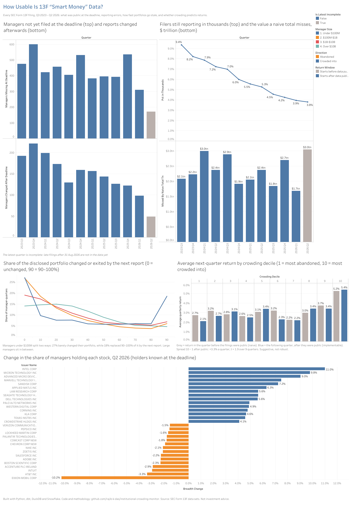

# Institutional Crowding Monitor

[](https://github.com/rajib-k-das/institutional-crowding-monitor/actions/workflows/ci.yml)

**How much of "smart money" 13F data is actually usable by the time you can see it?**

Every quarter, institutional managers with over $100M in US equities disclose their holdings to the SEC on Form 13F.
Investors, journalists and data vendors treat these filings as a map of what the professionals own. This project
rebuilds every 13F filing from Q3 2023 to Q2 2026 (~100,000 reports, ~40 million holding lines) as it stood on any
date, and measures three things most uses of the data quietly ignore:

1. **What was actually public at the filing deadline**, versus the picture after late filings and amendments.
2. **How wrong the raw numbers are:** filers that still report in thousands of dollars, and filers that swap the
   value and share columns.
3. **Whether "crowding" (managers piling into a stock) predicts anything** once only data that was public at the
   time is used.

Built with dbt on DuckDB, with the same models run on **Snowflake**, and a **Tableau Public** dashboard.

**[▶ Open the interactive dashboard on Tableau Public](https://public.tableau.com/app/profile/rajib.kumar.das/viz/InstitutionalCrowdingMonitor/Dashboard1)**

[](https://public.tableau.com/app/profile/rajib.kumar.das/viz/InstitutionalCrowdingMonitor/Dashboard1)

| Layer | Output | Status |
|---|---|---|
| Ingestion | SEC 13F data sets: download, header checks, load | ✅ Done |
| Staging | Typed filings and holding lines | ✅ Done |
| Intermediate | Report versions (SCD Type 2), reporting errors fixed, prices and splits from the filings | ✅ Done |
| Marts | Disclosure gaps, staleness, crowding deciles vs returns, breadth streaks | ✅ Done |
| Snowflake | Same models on Snowflake, plus Snowflake-specific features | 🔄 In progress |
| BI | [Tableau Public dashboard](https://public.tableau.com/app/profile/rajib.kumar.das/viz/InstitutionalCrowdingMonitor/Dashboard1) | ✅ Done |

## What the data showed

Figures cover report quarters Q3 2023 to Q1 2026; Q2 2026 is still incomplete (late filers after 31 Aug 2026 are
not in the data yet).

### 1. At the deadline, the picture is incomplete — and keeps changing for months

- **3.5–8.0% of managers had not filed by the 45-day deadline** (5.6% on average), so a snapshot taken at the
  deadline saw only **90–98% of the value** eventually reported.
- **100–220 managers a quarter changed their report after the deadline**: restatements arrive a median of 108 days
  after quarter end, and amendments adding forgotten holdings a median of 232 days after.
- Anyone backtesting on today's version of the data is using holdings that were not public at the time.

### 2. Three years after the SEC switched to whole dollars, some filers still report in thousands

- In January 2023 the SEC required values in whole dollars instead of thousands. **9.4% of filers still reported in
  thousands in Q3 2023, and 3.8% still did in Q2 2026**, including some of the largest managers.
- A naive sum of reported values therefore **misses $1.7–3.0 trillion a quarter (3–6% of the total).**
- A rarer error: **6–22 filings a quarter swap the value and share columns.** One state pension fund's filing lists
  "NVIDIA: 7,007,449,934 shares worth $35,021,490"; divide the other way and 7,007,449,934 ÷ 35,021,490 = $200.09,
  NVIDIA's exact quarter-end price.
- Both errors are detected per filing by comparing each position's implied price with the median price other
  managers report for the same stock ([decisions 005 and 013](docs/decisions.md)), and fixed.

### 3. A 13F is a portfolio that has already moved on

- For the **median manager, 23–29% of the disclosed portfolio (by value) had been exited or resized by more than
  10% by the next report**, and for about **1 in 4 managers, more than half** had.
- Full exits are rare (median about 1%): managers mostly resize rather than sell out, so the list of names in a
  13F stays accurate longer than the weights do.
- The smallest (under $100M) and the large ($10B–$100B) managers change most (median 36–37%); $100M–$1B managers
  least (23%).

### 4. Crowding: the most crowded stocks kept outperforming — but the evidence is thin

Each quarter, ~6,000 common stocks held by 10+ managers were ranked into ten groups by the change in the share of
managers holding them, using only reports public at the deadline. Average next-quarter price returns:

| | Most abandoned (1) | Groups 2–9 | Most crowded into (10) | Spread (10 − 1) | t-stat |
|---|---|---|---|---|---|
| Quarter starting **before** data public | 2.7% | 2.2–3.7% | 5.2% | 2.5% | 2.4 (10 quarters) |
| Quarter starting **after** data public | 2.1% | 2.2–3.4% | 5.4% | 3.3% | 1.9 (9 quarters) |

- The effect sits almost entirely in the most-crowded group; the other nine are close to one another.
- It did **not** shrink once lookahead was removed, so in 2024–26 crowding behaved like momentum rather than a
  crowded trade about to unwind.
- But it rests on 9 quarters, is driven by two of them (Q3 and Q4 2024: +9.3% and +11.2%), and was negative in 3
  of 9. It is suggestive, not a dependable signal.

### 5. Ownership itself mean-reverts

After **3 or more consecutive quarters of rising ownership**, the number of holders **fell the next quarter 59% of
the time**, against 39% for stocks in general (4,265 streaks).

### Latest quarter (Q2 2026)

Managers crowded into semiconductors and hardware (Intel +11 percentage points of managers, Micron, AMD, Marvell,
SanDisk, Applied Materials, Lam Research, Seagate, Dell) and left Exxon Mobil (−10 points), AT&T and software
(Intuit, Adobe, Salesforce).

## How it works

- **Every report as SCD Type 2.** Each original and amendment is a dated version of a manager's quarterly report;
  "what was public on date X" is a lookup, not a guess ([decision 004](docs/decisions.md)).
- **Prices from the filings themselves.** 13F values are quarter-end market values, so the median of value ÷ shares
  across managers gives each stock's quarter-end price, with no outside data ([decision 006](docs/decisions.md)).
- **Stock splits inferred** when holders' share counts jump by a whole multiple and the price falls by the same
  factor ([decision 009](docs/decisions.md)).
- **Deadlines follow the business-day rule,** including US federal holidays ([decision 008](docs/decisions.md)).
- **Corporate events are not crowding:** stocks whose holder count halved or doubled (acquisitions, spin-offs, new
  CUSIPs) are left out of the crowding analysis ([decision 014](docs/decisions.md)).

## Testing

dbt tests run on every push (GitHub Actions) on a set of hand-built filings covering every awkward case: values in
thousands, swapped columns, restatements, added holdings, a late filer, a 2-for-1 split, options and bonds. The key
results (deadline snapshots, breadth changes, staleness, split-adjusted returns) have hand-worked answers, and the
tests were checked to fail when the logic is deliberately broken. A test pins every quarter's filing deadline.

## How to run it

Requires Python 3.11+. The full build needs ~3 GB of memory (it runs on a free 2-core GitHub Codespace).

```bash
python3 -m venv .venv && source .venv/bin/activate
pip install -r requirements.txt

export SEC_USER_AGENT="Your Name your.email@example.com"   # the SEC asks automated clients to identify themselves
python ingest/download_13f.py        # about 1.5 GB of zips into data/
python ingest/load_13f.py
dbt build
python scripts/summarize_findings.py # disclosure gaps, reporting errors, staleness, crowding vs returns
python scripts/export_for_tableau.py # CSV files for the dashboard (exports/)
```

Hand-built test filings instead: `python ingest/load_13f.py --raw-dir tests/fixtures && dbt build`.

On Snowflake, with the same models: [docs/snowflake_guide.md](docs/snowflake_guide.md) (load through an internal stage,
`dbt build --target snowflake`, then `python scripts/compare_engines.py` to check both warehouses agree).

## Tech stack

Python · SQL · dbt Core · DuckDB · Snowflake · GitHub Actions (CI) · Tableau Public

Data: [SEC Form 13F data sets](https://www.sec.gov/data-research/sec-markets-data/form-13f-data-sets) (public).
Returns are price returns only and exclude dividends; nothing here is investment advice.
